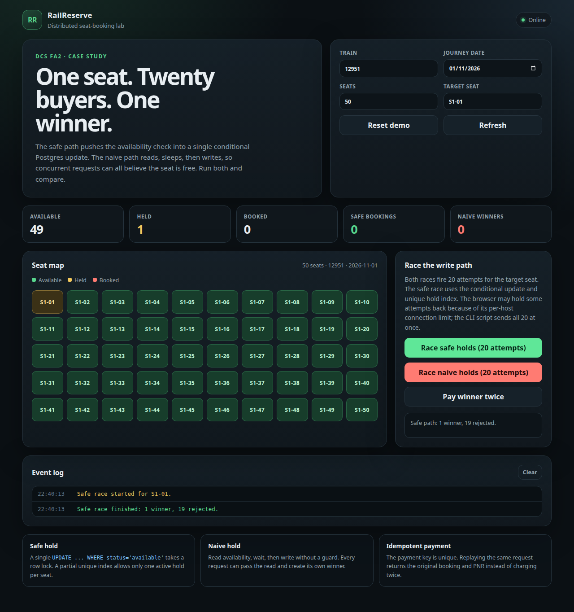
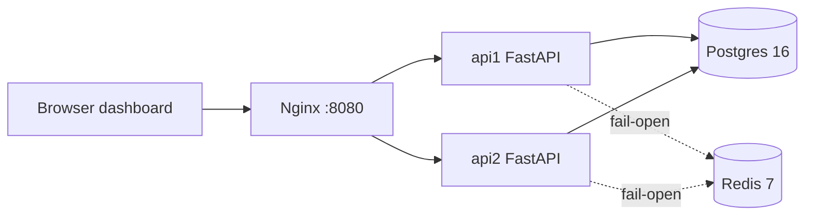

# RailReserve

**Preventing Double Booking in a Railway Reservation System**

A distributed-systems case study for the FA2 mini project. RailReserve exposes the classic check-then-act race that can double-book a railway seat, then shows how a database-enforced hold and an idempotent payment path prevent it.



## Deliverables

| File | Description |
| --- | --- |
| [`RailReserve_MiniProject_DCS.pdf`](RailReserve_MiniProject_DCS.pdf) | Final 27-page A4 report |
| [`RailReserve_MiniProject_DCS.docx`](RailReserve_MiniProject_DCS.docx) | Editable report |
| [`railreserve/`](railreserve/) | Runnable Docker implementation and tests |
| [`report/`](report/) | Report source, figures and build scripts |

## What it demonstrates

- **One winner per seat:** a conditional `UPDATE` plus a partial unique index on active holds. Twenty concurrent safe holds produce **1 × 201** and **19 × 409**.
- **The race, visibly:** a separate naive read-delay-write endpoint lets every concurrent request win.
- **Retry-safe payment:** ten concurrent payments with one idempotency key create **one booking and one payment**.
- **Inventory recovery:** an expiring hold TTL and sweeper return abandoned seats.
- **API-tier failover:** Nginx continues serving when one of two FastAPI replicas is stopped.
- **Reproducible evidence:** **15 tests pass** and the CLI demo reports **6/6 scenarios passed**.

## Architecture



Postgres is the authority for inventory. Redis is used only for fail-open rate limiting and is deliberately kept off the booking critical path.

## Quick start

```bash
cd railreserve
docker compose up --build -d
```

Open <http://localhost:8080>. To run the evidence:

```bash
docker compose run --rm api1 pytest -v
./scripts/demo.sh
```

See [`railreserve/README.md`](railreserve/README.md) for the API, demo flow, screenshots, configuration and design notes.

## Team

| Name | Roll number |
| --- | --- |
| Tony Prajapati | 123B1F079 |
| Vedant Patarwale | 123B1F069 |
| Pratik Rajput | 123B1F135 |
| Ishan Toraskar | 123B1F119 |

**Course:** Distributed Computing System (DCS) — FA2 Mini Project  
**Department:** Information Technology, PCCoE  
**Academic year:** 2026–27

## Scope

This is an educational prototype, not an IRCTC reproduction. It does not include a real payment gateway, authentication, waitlists, quotas, Tatkal rules, notifications or multi-region replication. The naive endpoint is a teaching control, never part of the safe booking flow.
