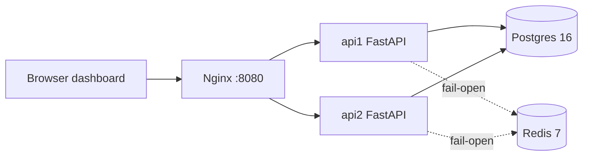

# FA2 Presentation Outline — RailReserve

Topic 6: IRCTC case study with a focused distributed-systems demo.

## At a glance

- Format: 5-minute presentation plus Q&A.
- Rubric: presentation 5 marks, concepts 3 marks, Q&A 2 marks.
- Live demo: dashboard at `http://localhost:8080`, backup output in
  `railreserve/demo-output.txt`.
- One-line thesis: "IRCTC-scale booking is a coordination problem. We built the
  smallest system that shows the coordination primitives and proves them under
  concurrency."

## Timing plan

| Time | Slides | Section | Owner |
| --- | --- | --- | --- |
| 0:00-0:30 | 1-2 | Problem, IRCTC scale, Tatkal | Presenter 1 |
| 0:30-1:00 | 3-4 | Naive race timeline and requirements | Presenter 2 |
| 1:00-1:30 | 5 | Proposed architecture | Presenter 2 |
| 1:30-2:15 | 6-7 | Safe hold, payment, expiry + demo | Presenter 3 (driver) |
| 2:15-2:45 | 8-9 | Consistency trade-off + naive demo | Presenter 3 |
| 2:45-3:15 | 10 | Node failure and recovery | Presenter 4 |
| 3:15-3:45 | 11 | Trade-offs and alternatives | Presenter 4 |
| 3:45-4:15 | 12 | Lessons learned | Presenter 1 |
| 4:15-5:00 | — | Q&A | All |

## Slide 1 — Title and problem

- IRCTC sells the same seat to thousands of concurrent buyers.
- The demo isolates one invariant: one seat, one winner.
- Everything else in the system exists to protect that invariant while staying
  available.

Speaker note: open with the invariant, not the technology. The audience should
know the success criterion before seeing the architecture.

## Slide 2 — IRCTC scale and Tatkal

- Public reporting: 30,155 tickets booked in one minute on 12 March 2025.
- About 13.88 lakh tickets per day in FY 2024-25; roughly 86.38% digital.
- The next-generation PRS targets more than 1.5 lakh bookings per minute and
  40 lakh enquiries per minute, phased in from August 2026.
- Tatkal opens at 10:00 for AC classes and 11:00 for non-AC classes, creating a
  thundering-herd workload.

Speaker note: these are public figures, not measurements from this demo. Add
the exact source citation from the report to the slide footer. The point is the
shape of the workload: a huge burst concentrated on a small inventory.

## Slide 3 — Naive race timeline

- Two requests both read `available`.
- Both sleep while the user completes checkout.
- Both write a booking; both believe they won.
- This is the classic check-then-act race.

Speaker note: walk the timeline left to right. The bug is not the sleep; the
sleep only widens the window. The bug is that the check and the write are
separate operations.

## Slide 4 — Requirements and invariants

- Exactly one active hold per seat.
- No double charge for one idempotency key.
- Holds expire and inventory returns automatically.
- The API tier survives one node failure.
- Redis is never on the booking critical path.
- Any replica can serve any request.

Speaker note: these are the testable requirements. The next slides map each one
to a design decision and a demo result.

## Slide 5 — Proposed architecture

- Browser → Nginx (`:8080`) → two FastAPI replicas → Postgres primary.
- Redis is used only for per-user rate limiting and fails open.
- Postgres is authoritative for seats, holds, bookings, and payments.
- A background sweeper releases expired holds.

Diagram to reuse:



Speaker note: the API is stateless, so any replica can take any request. That
is what makes the failover demo possible. The stateful component is the
database, and that is where the invariant lives.

## Slide 6 — Safe hold flow

- One conditional `UPDATE` checks availability and takes the row lock.
- A partial unique index allows only one active hold per seat.
- Expired holds are reclaimable; a sweeper releases them in the background.
- Holds have a TTL, so an abandoned checkout does not lock inventory forever.

SQL to show:

```sql
UPDATE seats
SET status = 'held', hold_id = %s, hold_expires_at = now() + ...
WHERE train_id = %s AND journey_date = %s AND seat_no = %s
  AND (status = 'available' OR (status = 'held' AND hold_expires_at < now()))
RETURNING id, seat_no, hold_expires_at;
```

Speaker note: the database, not the application, is the arbiter. The
conditional update is atomic under the row lock; the partial unique index is a
second line of defense that cannot be bypassed by a buggy client.

## Slide 7 — Payment idempotency and expiry

- Payment carries an idempotency key.
- Replaying the key returns the original booking and PNR.
- `payments.idempotency_key` and `bookings.idempotency_key` are unique.
- Expired holds are reclaimable inline and by the sweeper.

Speaker note: idempotency is what makes retries safe in a distributed system.
The unique key turns a duplicate request into a read, not a second charge.

## Slide 8 — Strong vs eventual consistency

- Seat allocation is a CP choice: consistency before availability for that row.
- The API tier and read path remain horizontally available.
- Redis is fail-open because rate limiting is less important than booking.
- Eventual consistency is acceptable for notifications and analytics, not for
  the seat winner.

Speaker note: be precise about scope. We are not claiming the whole system is
CP; only the seat-row decision is strongly consistent. That is the smallest
critical section that preserves the invariant.

## Slide 9 — Live demo results

- Safe race: one `201`, nineteen `409`.
- Inventory sweep: 200 attempts across 50 seats, 50 winners and 50 distinct
  seats.
- Naive race: multiple winners for one seat; the CLI backup shows 20/20.
- Payment: 10 concurrent payments with one key, one booking and one payment.
- Expiry: a forced-expired hold is reclaimed.

Speaker note: run the dashboard for the visual, then point at
`railreserve/demo-output.txt` for the exact six-scenario PASS output. The
dashboard may show fewer naive winners because of the browser's per-host
connection limit; the CLI sends all 20 at once.

## Slide 10 — Node failure and recovery

- `docker compose stop api1`
- Requests keep returning `200` through Nginx.
- `X-Upstream` shows the retry on the surviving replica.
- `docker compose start api1` restores the second replica.

Speaker note: the API tier is disposable. The database is the stateful
component and the real single point of failure in this design.

## Slide 11 — Trade-offs and alternatives

- Postgres conditional update: simple, durable, strong invariant; single
  primary is the limit.
- Redis lock: fast, but adds a dependency on the critical path and still needs
  durable confirmation.
- Optimistic versioning: workable, but retries and contention complicate the
  checkout flow.
- Queue-based serialization: excellent for throughput, but introduces lag and
  a new failure domain.
- Production scale needs partitioning by train/date/seat range and replication.

Speaker note: the goal is not to claim this is IRCTC's architecture. It is to
show the trade-off space and justify the smallest design that proves the
invariant.

## Slide 12 — Lessons learned and Q&A backup

- Put the invariant where the data lives.
- Make retries idempotent before making them fast.
- Measure the race, do not assume it.
- Keep a reproducible CLI backup for every live demo.
- The hard part is coordination, not the UI.

Speaker note: close on the invariant and the evidence. Then hand off to the Q&A
lead and keep the dashboard and `demo-output.txt` open.

## Group of four

| Role | Responsibility |
| --- | --- |
| Presenter 1 | Problem framing, IRCTC facts, conclusion |
| Presenter 2 | Architecture and data model |
| Presenter 3 | Demo driver: safe race, payment, naive race |
| Presenter 4 | Failover, trade-offs, Q&A lead |

Rehearse handoffs. The demo driver should keep a terminal open with
`./scripts/demo.sh` ready and a browser tab on the dashboard.

## Source checklist for Slide 2

- PIB / Ministry of Railways release for the 30,155 bookings in one minute record
  on 12 March 2025.
- IRCTC annual report or Ministry of Railways data for 13.88 lakh tickets per
  day in FY 2024-25 and 86.38% digital bookings.
- Ministry of Railways / IRCTC announcement for the new PRS target of 1.5 lakh
  bookings per minute and 40 lakh enquiries per minute.
- IRCTC Tatkal rules for the 10:00 AC and 11:00 non-AC opening times.

Paste the exact links used in the report into the slide footer or speaker notes;
do not invent URLs.

## Q&A bank

**Why not keep inventory in Redis for speed?**
Redis would make the check fast, but the invariant would still need an atomic
operation and durable confirmation. Postgres already gives atomic conditional
updates and durability. Redis stays on the non-critical path as a rate limiter
that fails open.

**What happens if two payments arrive at the same time?**
The unique key on `payments.idempotency_key` and `bookings.idempotency_key`
means only one insert can commit. The loser either sees the existing booking or
retries with the same key and gets the replay.

**What if the API replica dies mid-request?**
The hold transaction either commits or rolls back. If it committed, the hold
exists and can be paid. If not, the seat remains available. A retry is safe.

**What if Nginx dies?**
It is a single proxy in this demo. In production you would run multiple load
balancers or a managed load balancer with health checks. The stateless API
replicas are already ready for that.

**Why is the naive path in the code at all?**
It is the control group. Without it, the audience has to take our word that the
race exists. Running both makes the difference measurable.

**How does this relate to IRCTC scale?**
The same invariant applies at any scale; what changes is the number of
partitions and replicas. IRCTC's public target of 1.5 lakh bookings per minute
implies sharding by train, date, and seat range, plus asynchronous downstream
work such as PNR generation and notifications.

**What is the isolation level?**
The critical statement is a single `UPDATE ... WHERE`, which takes a row lock
under Postgres read-committed isolation. The winner is determined by the row
lock, not by application timing.

**What happens when a hold expires?**
The sweeper marks expired holds as `expired` and returns the seat to
`available`. A hold request can also reclaim an expired hold inline, so the
seat is never stuck waiting for the sweeper.

**Could the partial unique index be replaced by an application lock?**
An application lock only works if all writers cooperate and if the lock service
is available. The database index is the last line of defense and cannot be
bypassed by a buggy client.

**How do you test concurrency deterministically?**
The naive test uses a barrier so all 20 threads finish their read before any
thread writes. The safe test runs 20 real threads against Postgres and asserts
exactly one winner.

## Backup plan

- Keep `railreserve/demo-output.txt` open in a second tab.
- Have `docs/dashboard-safe-race.png`, `docs/dashboard-payment.png`, and
  `docs/dashboard-naive-race.png` ready as visual fallbacks.
- If the live demo fails, run `./scripts/demo.sh` in a terminal and narrate the
  output. The script exercises the same six proofs.
